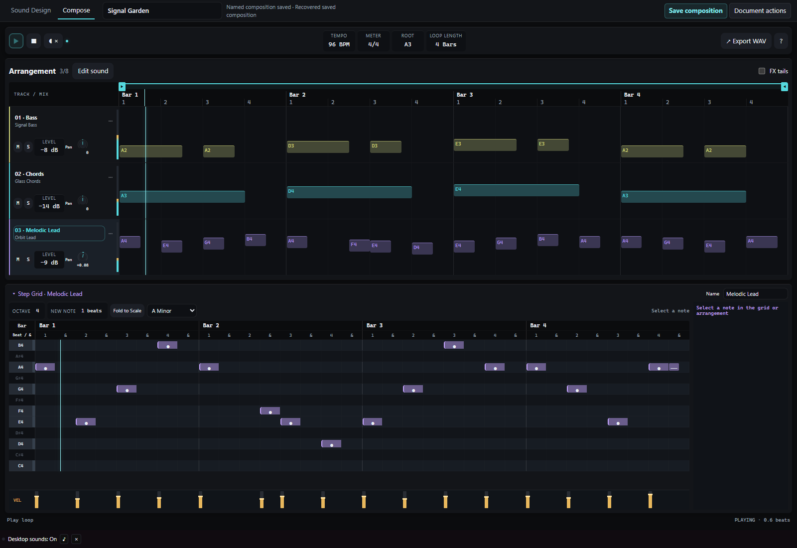
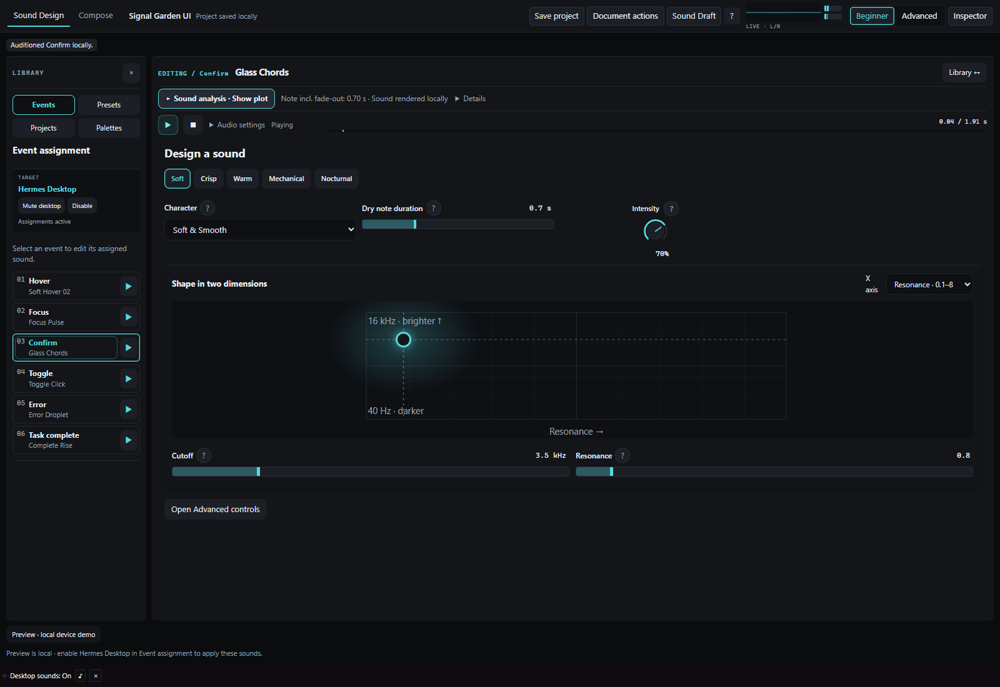
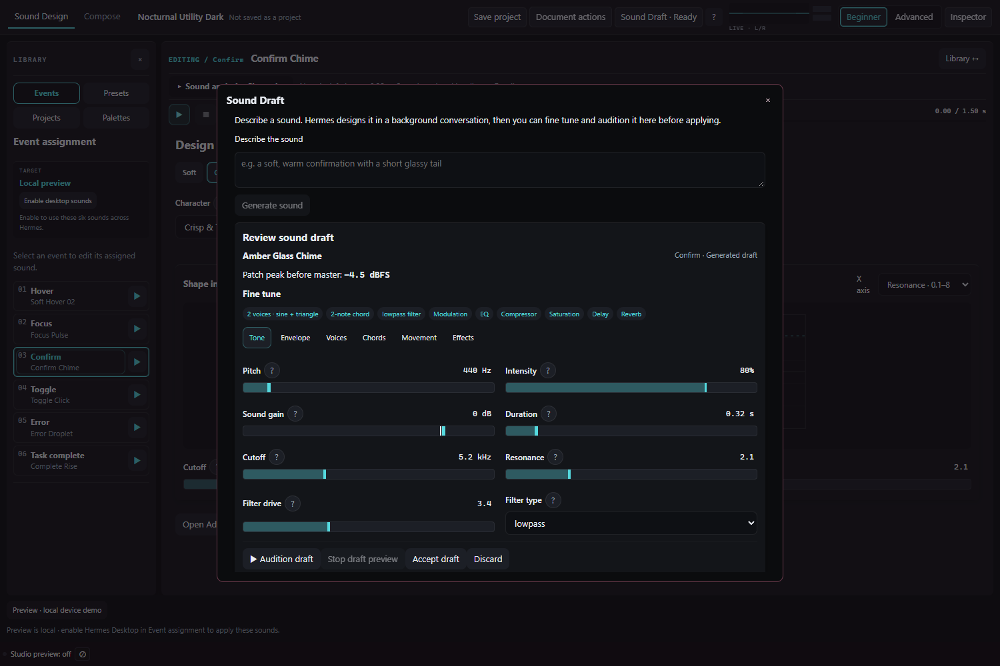

# Hermes Sound Studio

**Give Hermes a sound of its own.**

Design a sound, assign it to a desktop interaction, and hear the result as you use Hermes. Build a short loop from the same sounds, or export them for your own app.

Sound Studio is a Hermes Desktop plugin with a local synthesizer, an event sound designer and a compact composition workspace. **Sound Draft** designs a patch in a background Hermes conversation, then opens a feature-aware Fine tune review inside Studio. Manual sound design runs locally without an AI call or external audio assets.



## Try it in two minutes

1. Open **Sound Studio** in Hermes Desktop.
2. Select **Hover**, **Focus**, **Confirm**, **Toggle**, **Error** or **Task complete** in Event assignment.
3. Choose a style, shape the sound with the XY pad, and click **Audition**.
4. Click **Enable desktop sounds**. The target changes to **Hermes Desktop** and the six assignments become active. Editing a sound updates its assignment immediately.
5. Open **Compose** to program notes, velocity and layers, then **Export WAV**.

Audio starts off. Desktop sound controls stay in the status bar after you leave the editor. Mute or Disable them there; enablement is not saved across reloads.

## What you can make

| Workspace | What it does |
| --- | --- |
| Sound Design | Shape three oscillators, noise, chords, envelopes, filtering, modulation and effects. Beginner and Advanced edit the same patch. |
| Desktop target | Play the assigned patches on host hover, focus, confirm, toggle and validation events, plus focused-session errors and successful completions. |
| Compose | Arrange up to eight layers in a fixed workspace with a piano grid, scale folding, velocity, pan, live meters and editable loop bounds. |
| Export | Download a sound or loop as WAV; keep editable JSON or export a standalone TypeScript sound runtime. |





## Install

Requires **Hermes Desktop 0.23.0 or newer**. The supplied desktop bundle is ready to load; users do not need an npm build. Node.js is required only for the optional JSX/TSX developer tools.

For a local package, put the folder containing `plugin.yaml` in `<HERMES_HOME>/plugins/hermes-sonic-ui`, then run:

```sh
hermes plugins doctor hermes-sonic-ui --ci
hermes plugins enable hermes-sonic-ui
```

In Desktop's Plugins settings, rescan and enable **Hermes Sound Studio**, then open it from the sidebar. Use your configured Hermes home; its location varies by installation. Back up an existing plugin folder before replacing it.

Install the public repository directly while catalog review is pending:

```sh
hermes plugins install https://github.com/iKnz990/hermes-sound-studio
```

For a reproducible install, add `--ref` followed by the full 40-character commit SHA. Catalog installs will use the exact maintainer-reviewed pin after acceptance.

## Built for Hermes

The plugin adds its own sidebar route and status bar controls through the Desktop SDK. The agent half registers four tools:

- `sonic_create_patch`: validate a supplied patch or request an optional configured-model draft for review.
- `synthesize_ui_soundscape`: generate a six-event preset and its standalone TypeScript runtime; writing an `output_path` requires Hermes human approval.
- `audit_ui_silence`: inspect a requested JSX/TSX project for supported event hooks.
- `inject_sonic_hooks`: preview a hash-bound AST edit plan; applying it requires Hermes human approval and keeps backups.

Native file paths are checked against Hermes’s write denylist. Hermes home/profile, install and plugin trees are refused. The Node parser receives only PATH, HOME, LANG and (on Windows) SYSTEMROOT.

Sound Draft stays inside Studio and uses the active profile’s configured model. It shows progress and Cancel, validates the reply, and exposes the generated voices, chords, envelope, filter, modulation and effects under **Fine tune**. Audition and edit the candidate, then explicitly accept it. Existing chat drafts and event assignments stay unchanged until you act. The native `sonic_create_patch` tool remains available separately for validated/reviewable drafts; manual editing, synthesis, desktop sounds and exports remain available without inference.

## Build and verify

Use Node.js 22+ and Python 3.11+. CI runs the portable suite with Chromium on Windows, macOS and Linux. Real Hermes Desktop/model verification runs separately; see the verification notes for its prerequisites and evidence boundaries.

```sh
npm ci --ignore-scripts --no-audit --no-fund
npm run build
npm test
hermes plugins validate . --install-deps --json
```

Browser checks are separate:

```sh
python -m pip install -r requirements-dev.txt
python -m playwright install chromium
npm run test:browser
```

Set `PYTHON` to a Python executable if needed. Set `BROWSER_EXECUTABLE` to an installed Chromium/Chrome executable to use it instead of Playwright's download. [Verification notes](docs/verification.md) explain the test boundaries.

## Data and behavior

Sound editing and rendering are local. The desktop target observes trusted control interactions only after explicit enablement; it does not read typed content, rewrite Hermes UI or persist interaction logs. Hermes built-in notification settings remain independent.

Generating a Sound Draft sends your request, selected patch and JSON schema to the active profile’s configured model through a separate, hidden Hermes conversation and may incur normal model usage. Its transcript remains in Hermes storage; its runtime is released after completion or cancellation. The plugin never edits an existing conversation or reads model credentials. The developer tools read only the project the caller requests; injection writes only after explicit apply and keeps backups. They launch a bounded Node parser process without a shell. There is no separate background service, analytics endpoint, credential store or self-updater. See [disclosures](docs/disclosures.md).

## Scope

Compose supports 1–32 bars, eight layers and 2,048 notes. WAV contains one active loop plus effect tails. It is a compact loop instrument; song sections, stem export and free clip dragging are outside this release. Detailed use and compatibility notes are in the [user guide](docs/user-guide.md).

## License

MIT. The bundled TypeScript parser is Apache-2.0; see [third-party notices](THIRD_PARTY_NOTICES.md).
