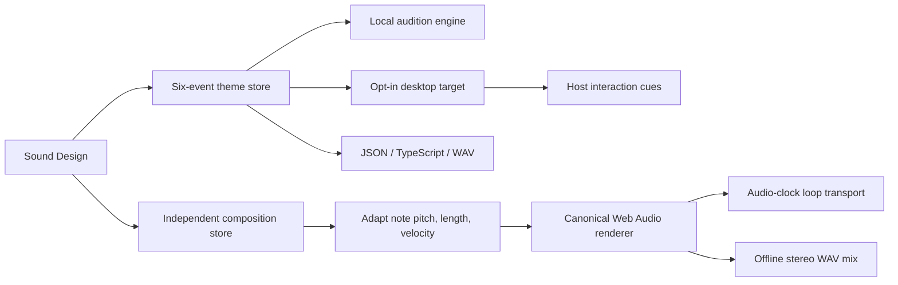

# Architecture

The desktop half is a bundled React/TypeScript plugin. The Python half registers sound validation/developer tools and a plugin-local compatibility API. The Sound Draft UI uses public `host.profileRoutes`, `host.retainProfile` and `host.requestProfile` APIs to run a separate background conversation without navigation or composer access. They share a versioned patch schema.

`assets/studio-engine.ts` is the import-free canonical precision renderer. Sound audition and exported precision TypeScript embed that source. Compose adapts musical notes into render-only copies, caches processed buffers, and feeds layer gain/pan into a shared bounded output stage.

The desktop target owns its own engine for the renderer lifetime. It subscribes to the live theme, attaches event listeners after explicit enablement and detaches on Disable/disposal. Local audition is independent. Scope changes invalidate pending target work without persisting consent.

The plugin owns the Sound Design and Compose audio engines for its lifetime. Views borrow them, stop playback and invalidate pending work when leaving, and detach their UI authority. Readiness and explicit mute survive route/task/session changes, including Sound Draft chats. The plugin keeps the preview theme current while the view is absent and releases both engines on unload. Reload starts a new audio session without persisted consent. Draft audition enables the main preview as well as its temporary candidate engine, keeping the controls consistent.

Stores distinguish editable recovery drafts from named saves and verify writes/readback. Replacement reviews bind their revision and target. Current working edits are not treated as proof of a durable save.

The background controller is plugin-owned and holds one exact connection/profile socket lease per explicit request. It reads the backend’s advertised create contract, creates a uniquely titled hidden conversation, sends once with a stable submission identity, and reads only that runtime’s replay events. The reply is validated before entering Fine tune; the candidate never writes the assigned event until acceptance. Newer edits invalidate acceptance. Profile changes cancel the captured owner’s work. Legacy runtimes close through `session.close`; canonical runtimes cancel the exact admission when needed and detach their own subscription. Hidden transcripts remain in Hermes storage. No core code, private stores, credentials or markup are accessed.

Readiness and candidate editing are independent: opening or tweaking a draft is silent, while Audition explicitly enables preview. The draft engine’s disposal timer follows its real rendered duration and effect tails. The main playback clock occupies a permanent transport slot; idle/playing updates cannot change the editor’s geometry.
